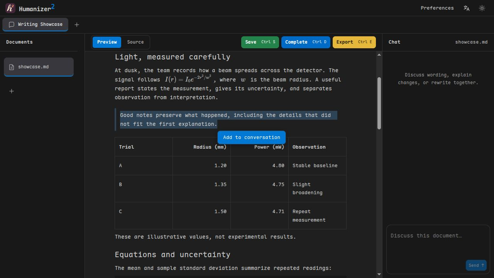
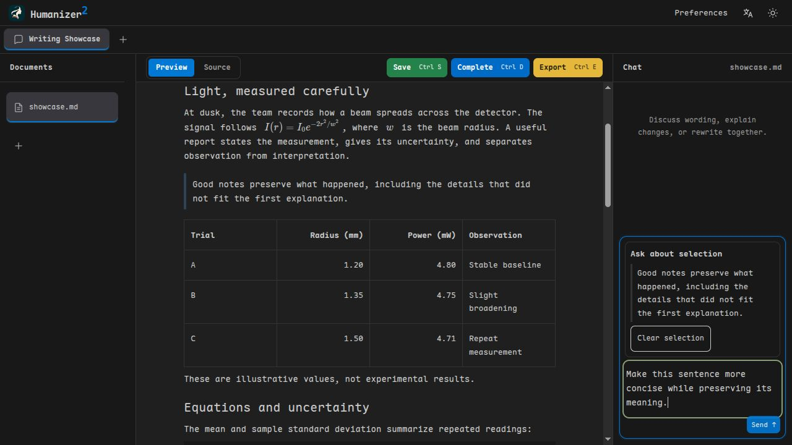
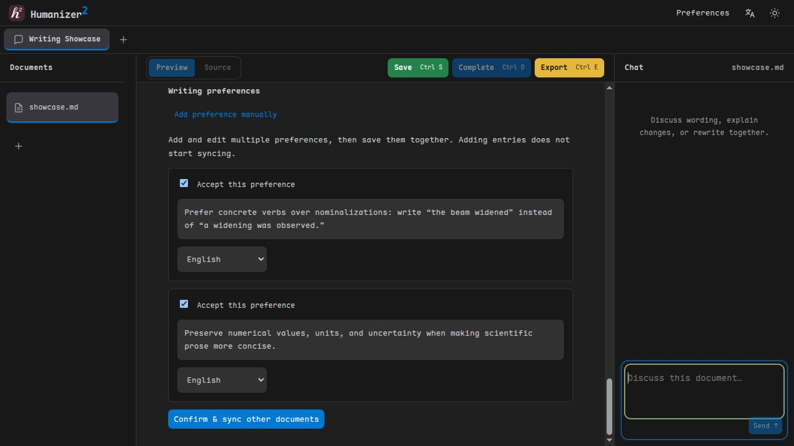
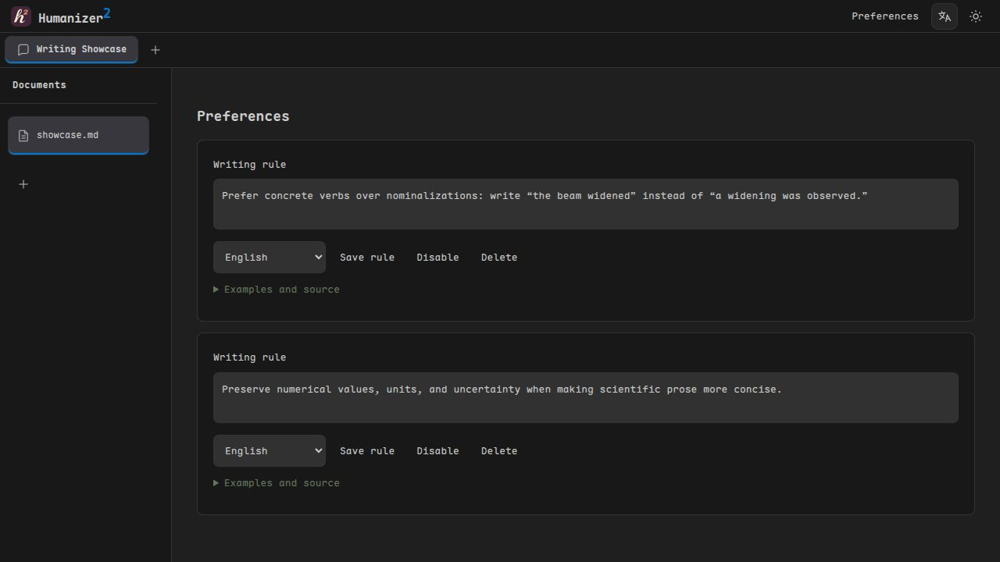

<p align="center">
  
</p>
<h1 align="center">Humanizer²</h1>
<p align="center"><strong>A humanizer that learns to humanize.</strong></p>
<p align="center"><a href="docs/README.zh-CN.md">中文</a> · Version <strong>0.1.2</strong></p>

Many AI-written documents have poor readability, so we often encounter two problems when reading them:

- The text needs extensive editing or restructuring.
- Unclear passages require a follow-up question to the model.

Existing Humanizer skills can help polish AI-generated text, but the result may still need human editing. Humanizer² improves the reading and editing workflow, learns from human edits, and gradually adapts to individual preferences:

- Integrates with a harness as a plugin; currently supports Codex desktop and CLI.
- Uses existing Humanizer skills for an initial polish.
- Brings the document editor and AI conversation together, reducing window switching.
- Can ask AI to extract writing preferences from the latest edits when a review is complete, then save them after human confirmation.

## Features in action

### Import documents

You can import multiple documents when opening the workbench. Humanizer² gives them an initial polish one by one. You can continue adding documents afterward; each document is bound to its corresponding session.

### Select text

Select a passage and add it to the conversation for a focused rewrite or question.





Each document's conversation history is displayed separately, even when the documents belong to the same session.

### Extract writing preferences

Click **Complete** or press **Ctrl+D**. If the current review contains changes, the workbench asks AI to extract writing preferences. You can also add and edit preferences manually; once confirmed, they are saved and used in subsequent polishing.



### Review saved preferences

Open **Preferences** in the upper-right corner to review, edit, disable, or delete saved preferences.



## Installation

Requires Node.js 22.18+, Git, and Codex with plugin marketplace support. The CLI package also requires `codex queue` and the local default daemon.

Add the plugin source:

```sh
codex plugin marketplace add https://github.com/liu-ws/Humanizer2.git
```

For local installation and development, download or clone the repository and run `codex plugin marketplace add .` from its root.

### Codex desktop

```sh
codex plugin add humanizer2@humanizer2
```

Restart Codex and ask it to open Humanizer² in the current chat. The desktop version opens an embedded workbench.

### Codex CLI

```sh
codex plugin add humanizer2-cli@humanizer2
```

Start a new CLI session, ask it to open Humanizer² through `humanizer2_cli`, and open the returned browser URL. Keep the original CLI session running. The URL contains a local access token; do not share it.

### Build from source

```sh
npm ci --ignore-scripts
npm run typecheck
npm run build
npm test
```

The build produces both plugin packages. Reinstall the desktop plugin and restart Codex after changing its package; start a new CLI session to reload its tools. `node scripts/preview.mjs` starts an isolated UI preview without a model connection.

## Project structure

```text
.agents/plugins/      Shared desktop and CLI marketplace catalog
assets/                English sample and workbench screenshots
docs/                  Chinese README
src/
  core/                Documents, requests, writing preferences, SQLite
  server/              Shared local service and MCP tools
  ui/                  React editor and conversation interface
  hosts/               Host adapters and desktop embedded bridge
plugins/
  codex-desktop/       Desktop package
  codex-cli/           CLI MCP package
scripts/               Build and preview utilities
tests/                 Automated checks
vendor/                Bundled rules, fonts, notices, and licenses
```

## Data storage

Data stays in `~/.local/share/humanizer2` by default. `workspace.sqlite` stores session registrations and shared preferences; `sessions/` stores each session's documents and requests. Set `HUMANIZER2_DATA_DIR` to isolate data.

## Service port
The service listens on `127.0.0.1:36678` and requires a local access token.

Disconnecting the last session shuts down the background service and releases its port. Saved documents and writing preferences remain on disk and are restored when you reopen Humanizer².

## Document rendering

The editor uses Milkdown/Crepe and ProseMirror, with KaTeX for equations. Rich editing can normalize Markdown spacing and list markers. Raw HTML and scripts are not executed. Code, link targets, tables, and frontmatter are protected from automatic prose edits.

Third-party notices and licenses are retained under `vendor/` and in the bundled packages.

## Contributing

Only the Codex desktop and Codex CLI plugins are implemented so far. Contributions for Claude Code and DeepSeek harness integrations are welcome. If you encounter a problem, open an issue or submit a pull request with a fix or improvement.

## License

[MIT](LICENSE) © 2026 Wenshuai Liu. Third-party components retain their own licenses.
