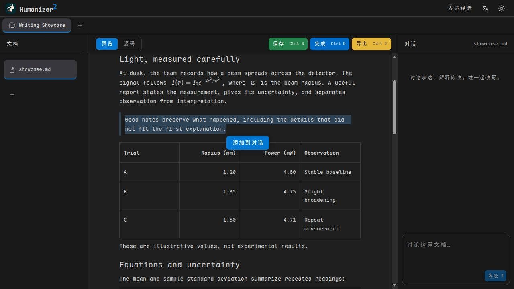
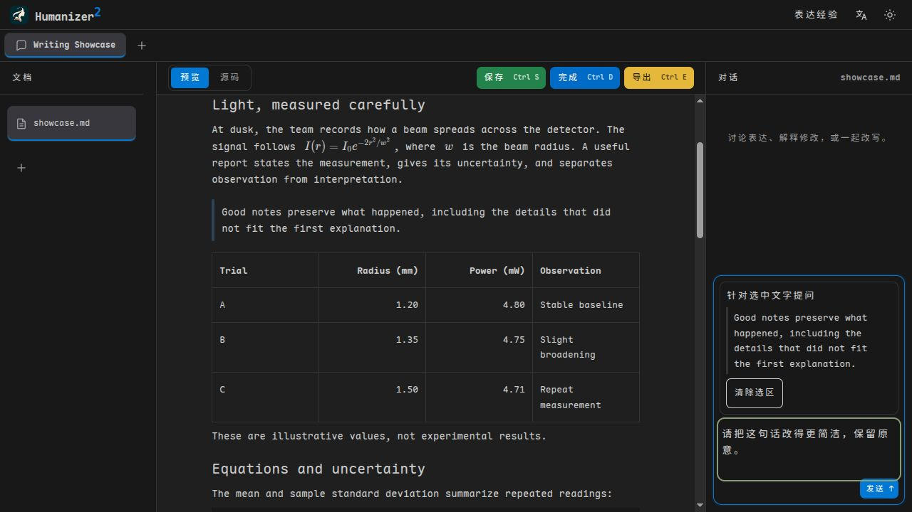
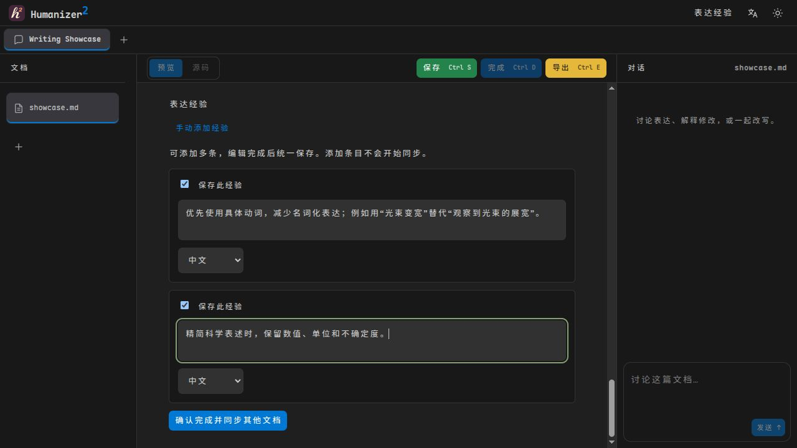
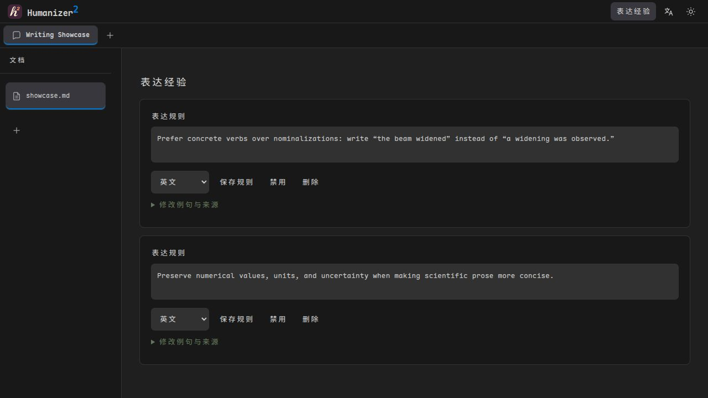

<p align="center">
  
</p>
<h1 align="center">Humanizer²</h1>
<p align="center"><strong>A humanizer that learns to humanize.</strong></p>
<p align="center"><a href="../README.md">English</a> · 版本 <strong>0.1.2</strong></p>

许多 AI 撰写的文档可读性很差，导致我们在阅读时经常遇到以下两种情况：

- 需要进行大量的微调甚至重构
- 遇到看不懂的地方，需要询问大模型

现有的 Humanizer 技能可以帮助 AI 润色文档，但结果仍可能需要人工修改。为了改善阅读和修改 AI 文档的体验，让 Humanizer 在人类编辑中积累经验，并逐步适应个人偏好，Humanizer² 诞生了：

- 作为插件与 Harness 集成，目前支持 Codex 桌面端和 CLI
- 根据已有的 Humanizer 技能对文档进行初步润色
- 集成文档编辑器和 AI 对话框，不用再在多个窗口之间切换
- 完成一篇文档的编辑后，可让 AI 根据本轮改动提取写作经验，由人类确认后保存

## 功能展示

### 导入文档

启动时可以导入多篇文档，Humanizer² 会逐个进行初步润色，启动后也可继续添加文档，文档与对应会话（session）绑定。

### 选中文字

当你选中一段文字时，可以将其添加到对话，进行针对性润色或提问。





与不同文档关联的对话记录会被单独展示，即使它们实际上属于同一个会话。

### 提取经验

点击“完成”或按 **Ctrl+D** 后，如果本轮有改动，工作台会请求 AI 提取经验。你也可以手动添加和修改经验，确认后会保存并用于后续润色。



### 查看经验

你可以点击右上角“表达经验”，查看、修改、禁用或删除已保存的经验。



## 安装

需要 Node.js 22.18+、Git，以及支持插件市场的 Codex。CLI 插件还需要 `codex queue` 和本机默认 daemon。

添加插件源：

```sh
codex plugin marketplace add https://github.com/liu-ws/Humanizer2.git
```

也可以在下载或克隆项目后，从项目根目录执行 `codex plugin marketplace add .`，用于本地安装和开发验证。

### Codex 桌面端

```sh
codex plugin add humanizer2@humanizer2
```

重启 Codex，在当前聊天中要求打开 Humanizer²。桌面端会打开内嵌工作台。

### Codex CLI

```sh
codex plugin add humanizer2-cli@humanizer2
```

重开 CLI 会话，要求通过 `humanizer2_cli` 打开 Humanizer²，访问返回的浏览器地址，并保持原 CLI 会话运行。地址含本地访问凭证，请勿分享。

### 从源码构建

```sh
npm ci --ignore-scripts
npm run typecheck
npm run build
npm test
```

构建会同时生成两端插件包。修改桌面插件后重新安装并重启 Codex；CLI 重开会话以加载新工具。`node scripts/preview.mjs` 可启动独立界面预览，不连接模型。

## 目录结构

```text
.agents/plugins/      桌面端与 CLI 共用的插件源目录
assets/                英文示例和工作台截图
docs/                  中文 README
src/
  core/                文档、请求、写作经验及 SQLite
  server/              共享本地服务与 MCP 工具
  ui/                  React 编辑器与对话界面
  hosts/               宿主适配和桌面内嵌桥
plugins/
  codex-desktop/       桌面安装包
  codex-cli/           CLI MCP 包
scripts/               构建与预览工具
tests/                 自动化检查
vendor/                内置规则、字体、声明和许可证
```

## 数据保存

默认数据目录为 `~/.local/share/humanizer2`。`workspace.sqlite` 保存会话登记和共享经验，`sessions/` 保存各会话的文档与请求。可通过 `HUMANIZER2_DATA_DIR` 隔离数据。

## 服务端口

服务监听 `127.0.0.1:36678`，使用本地访问凭证。

最后一个会话断开后，后台服务会自动退出并释放端口。已保存的文档和表达经验保留在本地，重新打开 Humanizer² 后可继续使用。

## 文档渲染

编辑器使用 Milkdown/Crepe 和 ProseMirror，公式使用 KaTeX。可视编辑可能规范化 Markdown 空格和列表标记。原始 HTML 与脚本不会执行。自动正文润色会保护代码、链接目标、表格和 frontmatter。

第三方声明与许可证保留在 `vendor/` 及插件包内。

## 参与贡献

目前只实现了 Codex Desktop 和 Codex CLI 的插件，欢迎提交 Claude Code 和 DeepSeek harness 的实现 PR。如果您在使用过程中遇到了什么问题，欢迎在 Issues 中讨论，或者提交 PR 进行修复或增强。

## 许可证

[MIT](../LICENSE) © 2026 Wenshuai Liu。第三方组件遵循各自许可证。
